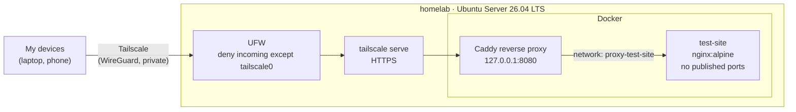

# homelab-infrastructure

Self-hosted infrastructure for running my projects as live demos on a repurposed laptop. Everything runs in Docker behind a single reverse proxy, and the server is reachable only over Tailscale, with no ports opened on the home router.

## Demo

There is no public demo yet. The server is private to my tailnet until Cloudflare Tunnel is added. This is what a request to the test page looks like from one of my devices:

```console
$ curl -sSI https://homelab.<tailnet>.ts.net/
HTTP/2 200
content-type: text/html
referrer-policy: strict-origin-when-cross-origin
via: 1.1 Caddy
x-content-type-options: nosniff
```

- `HTTP/2 200` with no certificate error: HTTPS is terminated by Tailscale with a valid certificate.
- `via: 1.1 Caddy`: the request went through the reverse proxy.
- No `server` header: Caddy hides which software and version is running behind it.

## What it does

- Runs each project as its own container behind one reverse proxy.
- Gives my devices private HTTPS access from anywhere, without port forwarding.
- Isolates services from each other and from the local network.
- Comes back up on its own after a reboot or power loss, with the lid closed.
- Keeps the whole server setup in Git: the Mac pushes, the server only pulls.

## Architecture



All traffic reaches the server over Tailscale. `tailscale serve` terminates TLS and forwards plain HTTP to Caddy on `127.0.0.1:8080`, which is the only published port on the machine. Caddy routes each request to a service over a Docker network that only the two of them share. Nothing is exposed on the local network or the internet.

Each project lives in its own repository and is built as an image in GitHub Actions. This repository only describes how the images are run.

### Hardware

| Part    | Spec                                     |
| ------- | ---------------------------------------- |
| Machine | ASUS X540L laptop                        |
| CPU     | Intel Core i3-5005U, 2 cores / 4 threads |
| RAM     | 8 GB                                     |
| Storage | 120 GB SATA SSD                          |
| Network | 100 Mbit/s Ethernet                      |

The machine is weak, so images are never built on the server, and every app must stay under about 300 MB of RAM.

## Tech stack

| Component        | Choice                          | Why                                                                                                                           |
| ---------------- | ------------------------------- | ----------------------------------------------------------------------------------------------------------------------------- |
| Operating system | Ubuntu Server 26.04 LTS         | Long-term support, small footprint, unattended security upgrades.                                                             |
| Containers       | Docker Engine, Docker Compose   | One folder and Compose project per service; the same images run locally and on the server.                                    |
| Reverse proxy    | Caddy 2                         | Short, readable config and sensible defaults. Single entry point for all services.                                            |
| Private access   | Tailscale and `tailscale serve` | Encrypted access from my devices without port forwarding, plus HTTPS certificates with no certificate handling on the server. |
| Firewall         | UFW                             | Simple rules: deny everything incoming except the Tailscale interface.                                                        |
| Test service     | nginx (`nginx:alpine`)          | A small static page to prove the full path before real apps are added.                                                        |

## Security

| Measure                                                                  | Why                                                                               |
| ------------------------------------------------------------------------ | --------------------------------------------------------------------------------- |
| No port forwarding on the router                                         | The server is not reachable from the internet.                                    |
| Tailscale for all access                                                 | Encrypted, authenticated access from my devices only, also from outside the home. |
| UFW denies all incoming traffic except on `tailscale0` (IPv4 and IPv6)   | Blocks the LAN and the server's public IPv6 address.                              |
| SSH keys only, no root login                                             | Password guessing is not possible.                                                |
| Caddy is the only entry point, bound to `127.0.0.1`                      | Services publish no ports, and Docker-published ports can bypass UFW.             |
| One Docker network per service, shared only with Caddy                   | Services cannot reach each other, which limits the damage if one is compromised.  |
| `no-new-privileges` on all containers                                    | A process inside a container cannot gain more privileges than it started with.    |
| Caddy drops all Linux capabilities except `NET_BIND_SERVICE`             | The proxy faces all traffic, so it gets only the one privilege it needs.          |
| Site files and Caddyfile mounted read-only                               | A compromised container cannot change what it serves or how traffic is routed.    |
| `Server` header removed, `nosniff` and `Referrer-Policy` added           | Hides the software behind the proxy and adds basic browser protections.           |
| TLS terminated by Tailscale, not by Caddy or the apps                    | No private keys or certificate renewal on the server.                             |
| User not in the `docker` group                                           | Membership is equivalent to root without `sudo`.                                  |
| Unattended security upgrades                                             | Known vulnerabilities are patched automatically.                                  |
| The server only pulls from GitHub and has no write access                | A compromised server cannot change the code.                                      |
| No secrets, Tailscale addresses or local IP addresses in this repository | Nothing here helps an attacker find or access the server.                         |

## Repository layout

```text
.
├── README.md
├── LICENSE
├── .gitignore
└── services/
    ├── proxy/              # Caddy reverse proxy, the single entry point
    │   ├── compose.yaml    # Published only on 127.0.0.1:8080
    │   └── Caddyfile       # Routes and security headers
    └── test-site/          # Static test page served by nginx
        ├── compose.yaml    # No published ports, creates the proxy-test-site network
        └── site/
            └── index.html
```

## Running

Requires Docker Engine with Compose and Tailscale on the server. Each service creates its own network, so start the services before the proxy:

```bash
cd services/test-site && sudo docker compose up -d
cd ../proxy && sudo docker compose up -d
sudo tailscale serve --bg 8080
```

All containers use `restart: unless-stopped`, and `tailscale serve --bg` keeps its configuration, so this is only needed once.

### Adding a service

1. Create `services/<name>/compose.yaml` with no published ports, a network named `proxy-<name>` and the alias `<name>`.
2. Add `proxy-<name>` as an external network for Caddy in `services/proxy/compose.yaml`.
3. Add a route to the service in `services/proxy/Caddyfile`.
4. Start the service, then restart the proxy.

## Testing

The setup is tested by hand. Last verified on 2026-11-07.

| Test                           | How                                                                          | Expected result                                             |
| ------------------------------ | ---------------------------------------------------------------------------- | ----------------------------------------------------------- |
| HTTPS through the proxy        | `curl -sSI https://homelab.<tailnet>.ts.net/` from a device on the tailnet   | `HTTP/2 200` and `via: 1.1 Caddy`, no certificate error     |
| Private to the tailnet         | Open the page on a phone with Tailscale on, then off                         | Loads with Tailscale on, fails with it off                  |
| No ports published by services | `sudo docker ps --format 'table {{.Names}}\t{{.Ports}}'`                     | Only Caddy has a mapping, and only `127.0.0.1:8080->80/tcp` |
| What `tailscale serve` exposes | `sudo tailscale serve status`                                                | `tailnet only`, `/` proxied to `http://127.0.0.1:8080`      |
| SSH from the LAN is blocked    | `ssh` to the server's LAN address from another machine                       | Connection times out                                        |
| Survives a reboot              | `sudo reboot`, then repeat the tests above without starting anything by hand | Docker, both containers and `tailscale serve` are back      |
| Lid closed                     | Close the lid and repeat the HTTPS test                                      | The server keeps running                                    |

## Roadmap

- [x] Ubuntu Server, SSH hardening and firewall
- [x] Tailscale access and Docker test page
- [x] Reverse proxy (Caddy) in front of all services
- [x] Tested in the browser, from a phone and after a reboot
- [ ] First project as a live demo, deployed by hand
- [ ] Public access through Cloudflare Tunnel
- [ ] Automatic deploy from GitHub
- [ ] Monitoring with alerts to my phone
- [ ] Off-site backup
- [ ] Policy checks for the Compose files (no published ports, `no-new-privileges`, dropped capabilities)

Known limitations:

- No full-disk encryption, so the server can restart without someone typing a password locally. Anyone with physical access to the laptop can read the disk.
- One machine with no redundancy. If the laptop fails, every demo is down until it is restored.
- Deploys are manual (`git pull` and `docker compose up -d`) until automatic deploy is in place.
- No monitoring or backup yet.
- The test page runs the stock `nginx:alpine` image, whose master process runs as root inside the container. Real apps must run as a non-root user.

## Licenses and attribution

- The configuration in this repository is licensed under the [MIT License](LICENSE).
- [Caddy](https://caddyserver.com/) is licensed under Apache 2.0.
- [nginx](https://nginx.org/) is licensed under the 2-clause BSD license.
- [Tailscale](https://tailscale.com/) is used as a service. Its client is partly open source under the BSD 3-clause license.
