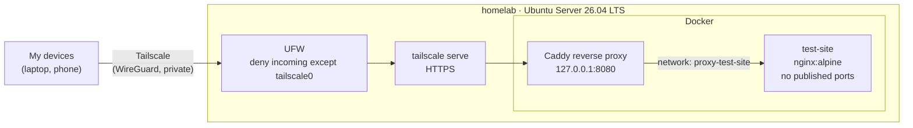

# homelab-infrastructure

Self-hosted infrastructure for running my projects as live demos on a repurposed laptop, without opening any ports on the home router.

## Architecture



All traffic reaches the server over Tailscale and enters the containers through Caddy. Nothing is exposed on the local network or the internet.

## Hardware

| Part    | Spec                                     |
| ------- | ---------------------------------------- |
| Machine | ASUS X540L laptop                        |
| CPU     | Intel Core i3-5005U, 2 cores / 4 threads |
| RAM     | 8 GB                                     |
| Storage | 120 GB SATA SSD                          |
| Network | 100 Mbit/s Ethernet                      |

## Security

| Measure                                                                | Why                                                                               |
| ---------------------------------------------------------------------- | --------------------------------------------------------------------------------- |
| No port forwarding on the router                                       | The server is not reachable from the internet.                                    |
| Tailscale for all access                                               | Encrypted, authenticated access from my devices only, also from outside the home. |
| UFW denies all incoming traffic except on `tailscale0` (IPv4 and IPv6) | Blocks the LAN and the server's public IPv6 address.                              |
| SSH keys only, no root login                                           | Password guessing is not possible.                                                |
| Caddy is the only entry point, bound to `127.0.0.1`                    | Services publish no ports, and Docker-published ports can bypass UFW.             |
| One Docker network per service, shared only with Caddy                 | Services cannot reach each other, which limits the damage if one is compromised.  |
| Dropped capabilities and `no-new-privileges`                           | Containers get only the privileges they need.                                     |
| User not in the `docker` group                                         | Membership is equivalent to root without `sudo`.                                  |
| Unattended security upgrades                                           | Known vulnerabilities are patched automatically.                                  |
| No secrets in this repository                                          | Secrets live only on the server, never in Git.                                    |

## Repository layout

```text
services/
  proxy/          # Caddy reverse proxy, the single entry point
    compose.yaml
    Caddyfile
  test-site/      # Static test page served by nginx
    compose.yaml
    site/
```

Each service has its own folder, Compose project and network.

## Running the services

Each service creates its own network, so start the services before the proxy:

```bash
cd services/test-site && sudo docker compose up -d
cd ../proxy && sudo docker compose up -d
sudo tailscale serve --bg 8080
```

## Adding a service

1. Create `services/<name>/compose.yaml` with no published ports, a network named `proxy-<name>` and the alias `<name>`.
2. Add `proxy-<name>` as an external network for Caddy in `services/proxy/compose.yaml`.
3. Add a route to the service in `services/proxy/Caddyfile`.

## Roadmap

- [x] Ubuntu Server, SSH hardening and firewall
- [x] Tailscale access and Docker test page
- [x] Reverse proxy (Caddy) in front of all services
- [ ] First project as a live demo
- [ ] Public access through Cloudflare Tunnel
- [ ] Automatic deploy from GitHub
- [ ] Monitoring
- [ ] Off-site backup
